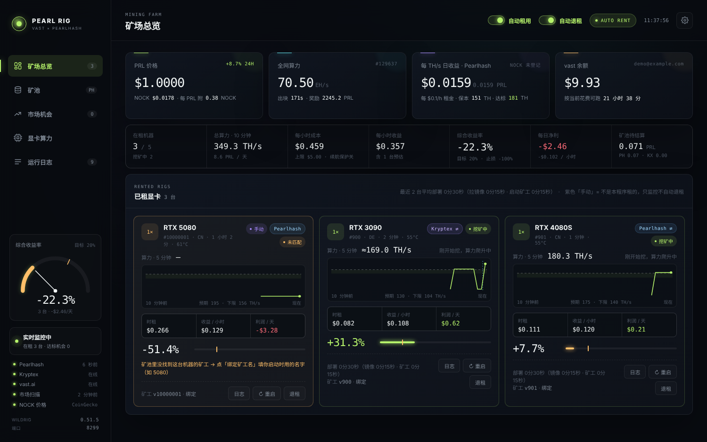
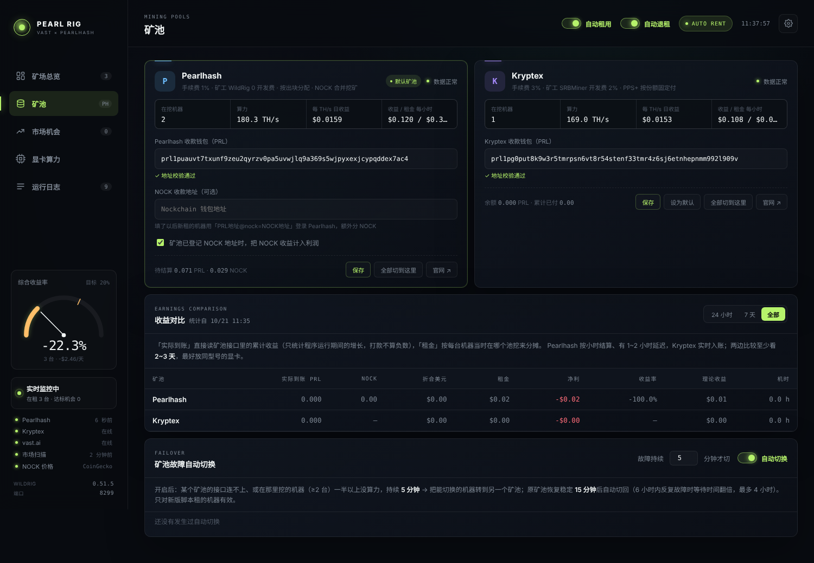
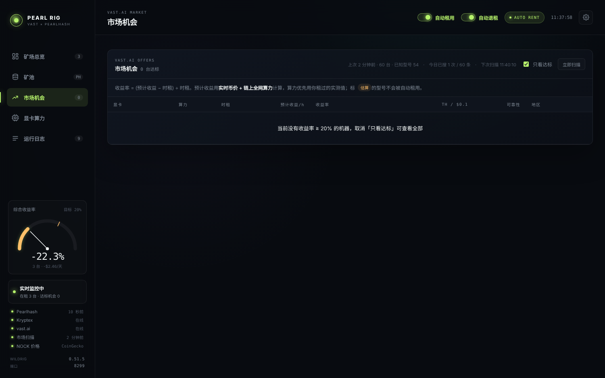

# PRL Vast AutoMiner · vast.ai 自动租卡挖 Pearl

**按利润率在 vast.ai 自动租显卡挖 Pearl（PRL），实时监控收益与算力，支持 Pearlhash / Kryptex 双矿池一键切换。** 本地网页控制台，Windows 双击即用。

*An open-source local dashboard that rents GPUs on vast.ai when Pearl (PRL) mining is profitable, deploys the miner automatically, tracks real-time profit per rig, and lets you switch rigs between the Pearlhash and Kryptex pools. Documentation is in Chinese.*



## 功能

- **自动租用**：按「实时币价 + 链上全网算力 + 矿池费用」计算每台可租机器的收益率，达到你设定的目标就自动租下并部署挖矿。有台数、花费、余额、续航等上限。精准搜索只搜有可能达标的型号、一轮可连续租多台、自动屏蔽反复租不到的「假机器」。
- **自动部署**：租下的机器自动下载矿工（多个下载源并行，谁快用谁）、守护运行、崩溃自动重启。默认跳过 vast 的 SSH 初始化，开机就挖。
- **实时监控**：每台机器的算力曲线、逐卡算力、实时收益率，算力异常标红，一键重启 / 退租，查看机器日志。
- **自动退租与止损**：部署失败、掉线、持续低于止损线时自动退租，并把问题机器拉黑。
- **双矿池**：Pearlhash（1%，含 NOCK 合并挖矿）与 Kryptex（PPS+ 3%）。每个矿池可以用不同钱包；单台或全部一键切换（不用重启机器，1~2 分钟生效）；矿池故障时自动转移、恢复后切回；按实际到账对比两个矿池的真实收益率。
- **NOCK 收益**：Pearlhash 合并挖矿的 NOCK 收益可以计入利润。
- **安全**：只监听本机 `127.0.0.1`，API Key 和钱包只保存在本地，无任何第三方依赖、不上传数据。

| 矿池页 | 市场机会 |
|---|---|
|  |  |

## 快速开始

1. 下载本仓库（右上角 **Code → Download ZIP**）并解压。
2. **Windows**：双击 `一键启动.bat`。**macOS / Linux**：运行 `./start.sh`。
   电脑上没有 Node.js 22+ 时会自动下载便携版到 `runtime/`（校验官方 SHA256，不装进系统）。
3. 浏览器自动打开 http://127.0.0.1:8290 ：
   - ⚙ 设置里填 **vast.ai API Key**（https://cloud.vast.ai/manage-keys/）
   - 左侧「矿池」页填 **PRL 钱包地址**（Pearl 官方钱包：https://github.com/pearl-research-labs/pearl/releases）
   - 确认无误后打开右上角「自动租用」

**每一项信息去哪里获取、每个页面和设置是什么意思、推荐怎么设置、常见问题，见完整的 [使用说明.md](使用说明.md)。**

## 更新记录

- **v1.1.0**：vast 精准搜索、一轮连续租多台、屏蔽假机器；修复「挖了很久的机器被 vast 短暂报离线就立刻退租」等 4 个问题。详见 [使用说明 · 更新记录](使用说明.md#25-更新记录)。
- **v1.0.0**：首个开源版本。

## ⚠ 风险提示

- 打开自动租用后会**真实扣除** vast.ai 余额。先小额测试。
- 挖矿收益随币价、全网算力、矿池运气和租金变化，**可能亏损**。本项目不构成任何投资建议，作者不对任何收益或损失负责。
- 请自行确认 vast.ai 服务条款和当地法规是否允许挖矿。
- 矿工软件：WildRig Multi（挖 PRL 0 开发费）、SRBMiner-MULTI（约 2% 开发费，仅 Kryptex 使用），均从其 GitHub 官方发布页下载。

## 运行测试

```bash
node test/run.mjs
```

所有外部接口（vast / 矿池 / GitHub / 行情）都是模拟的，不会真的租机器；测试在系统临时目录的副本里运行，不会碰你的 `data/`。

## 作者

X:@zaijin338191 （https://x.com/zaijin338191）

## 许可证

[MIT](LICENSE) © 2026 X:@zaijin338191。与 vast.ai、Pearl Research Labs、Pearlhash、Kryptex、WildRig、SRBMiner 均无关联。
